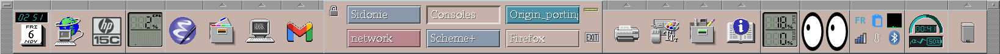
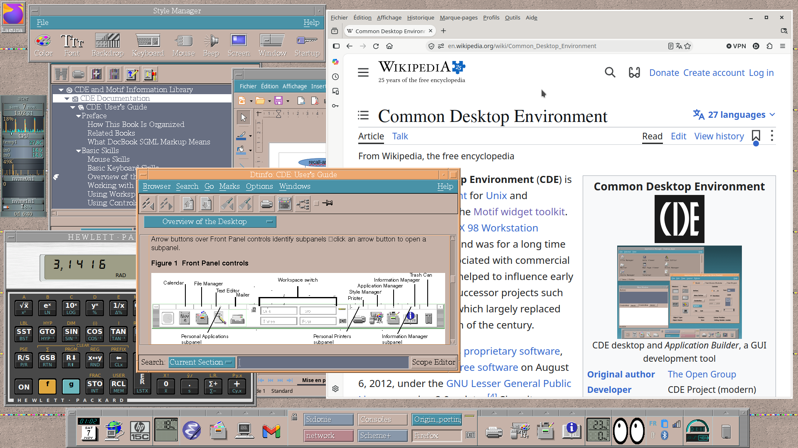

# cde-config

My personal **CDE** (Common Desktop Environment) setup on Ubuntu: the contents of
`~/.dt`, with a Front Panel brought up to date while staying true to the CDE look.

## What's inside

**Front Panel** (`types/*.fp`)
- Dockapps embedded in the panel (`TYPE client` controls): `wmclock` (a click opens
  Google Calendar), `wmcpuload`, `wmmemload`, `wmbattery`, and `xeyes`.
- A 3×2 `stalonetray` system tray inside the panel (network, Bluetooth, clipboard
  history, IBus, Psensor…). dtwm keeps the right click for its own panel menu, so
  **middle-click or Ctrl+left-click** an icon to get the app's menu (`src/trayclick.c`;
  works with Qt apps such as Telegram, GTK 3 applets ignore it and use their left
  click). Build: `gcc -O -o ~/.dt/bin/trayclick ~/.dt/src/trayclick.c -lX11`.
- Buttons for Firefox, the HP-15C simulator, Emacs, Gmail (in Firefox) and an HP
  printer; the Home Folder button opens Nautilus; the CDE trash at the far right.

**Subpanels** (`types/fp_dynamic/*.fp`): the CDE File Manager, Nautilus trash, an applications
folder, `xfce4-appfinder`, the CDE calendar, Dropbox (in a terminal that shows its
sync status), power settings, presentation mode, network connections, screen off,
screenshot, qps, Psensor, gkrellm…

**Keyboard** (`dtwmrc`, a copy of `sys.dtwmrc` plus bindings)
- Volume, mute and mic mute → `volume.sh` (a single notification bubble, capped
  at 120 %).
- Brightness → `brightness.sh` (logind `SetBrightness`, perceptual steps, down to
  backlight off).
- Print Screen → `xfce4-screenshooter`.
- Desktop right-click menu: **Close Window** → `src/closewin.c`: a crosshair, click a
  window and only that window is asked to close (`WM_DELETE_WINDOW`), unlike `xkill`
  which kills the whole client with all its windows. (dtwm greys out `f.kill` in the
  root menu.) Build: `gcc -O -o ~/.dt/bin/closewin ~/.dt/src/closewin.c -lX11`.

**Scripts**
- `sessions/sessionetc`: run by CDE at login; starts the dockapps, the tray,
  `nm-applet`, `blueman-applet`, `xfce4-clipman` and Dropbox.
- `panel-applets-watch.sh`: after "Restart Workspace Manager", maps
  `wmcpuload`/`wmmemload` again and relaunches `xeyes` (also after resuming from
  suspend).
- `lock-on-sleep.py`: locks the screen with CDE (`lock-cde.sh`, i.e. `dtaction
  LockDisplay`) before every suspend, holding a logind delay inhibitor like
  `xfce4-screensaver` does. CDE predates suspend and doesn't lock by itself then.
- `battery-alarm.sh`: a sound and a notification when the battery, discharging,
  drops below 30 % then 10 % (`wmbattery -a` writes to `/dev/audio`, which no
  longer exists); `wmbattery -l 30 -c 10` turns its icon yellow/red at the same
  levels.
- `xeyes-panel.sh`, `wmmemload-panel.sh`, `tray-panel.sh`, `xclock-toggle.sh`,
  `presentation-toggle.sh`, `dropbox-*.sh`.

## Installation

1. Copy the files into `~/.dt` (back up your own first).
2. Replace `/home/mattei` with your home directory in the files that contain it:
   `grep -rl /home/mattei ~/.dt`.
3. Make CDE the only screen locker (otherwise `xfce4-screensaver` cannot lock a
   screen CDE has already locked, and the suspend stops on a question):
   `xfconf-query -c xfce4-power-manager -p /xfce4-power-manager/lock-screen-suspend-hibernate -s false`,
   `xfconf-query -c xfce4-screensaver -p /lock/sleep-activation -s false`, and
   `xfconf-query -c xfce4-session -p /general/LockCommand -s $HOME/.dt/lock-cde.sh`
   (for `xflock4`).
4. Right-click the desktop → **Restart Workspace Manager**, then log out and back in
   so that `sessionetc` runs.

Packages used (Ubuntu): `wmclock wmcpuload wmmemload wmbattery x11-apps
stalonetray network-manager-gnome blueman xfce4-clipman xfce4-power-manager
xfce4-screenshooter pavucontrol nautilus xdotool x11-utils libnotify-bin
papirus-icon-theme`.

## Power saving, screen and lock: who does what

**Screen and system sleep: `xfce4-power-manager`** (Desktop Style subpanel →
**Power**, or `xfce4-power-manager-settings`). My settings:

| Setting | On AC | On battery | Tab |
|---|---|---|---|
| Dim the screen | 20 min | 5 min | Display |
| Screen standby | 25 min | 15 min | Display |
| Screen off | 30 min | 25 min | Display |
| System sleep when inactive | 45 min | 14 min | System |
| Lid closed | suspend | suspend | General |
| Power button | suspend | – | General |

- Don't use "Ask" for the power button: under CDE (no `xfce4-session`) it logs the
  session out at once.
- Keep "Lock screen when system is going to sleep" unchecked: CDE handles the
  lock (below), and two lockers block each other.
- The **presentation mode** button (Desktop Style subpanel) suspends all these
  timers; click it again to turn it off.

**Screen lock: CDE only**
- After inactivity: Style Manager → **Screen** (30 min here; the CDE screen saver is
  off).
- By hand: the padlock on the Front Panel.
- Before every suspend (lid, power button, inactivity): `lock-on-sleep.py`, started
  by `sessionetc`. Nothing to set.

**Left idle**: `xfce4-screensaver` still runs but neither locks nor shows a saver
(`/lock/sleep-activation`, `/saver/enabled` and `/saver/idle-activation/enabled`
are false). Don't turn it back on, or the two lockers fight again: CDE's lock grabs
the keyboard, `xfce4-screensaver` then fails, and the power manager stops the
suspend on a question nobody answers.

**Brightness**: the keys go to `brightness.sh`; "Handle display brightness keys" is
off in the power manager.

**Keyboard backlight** (Acer Aspire A517-53): Linux has no control over it (no
`kbd_backlight` LED, it is driven by the embedded controller). Enable "Keyboard
Lighting Timeout" in the BIOS (F2): the keyboard goes dark after about 30 s without
a key press.

**Order of events**: on AC the screen goes off at 30 min, when CDE locks; on
battery the laptop suspends at 14 min and is locked by `lock-on-sleep.py`. Either
way, the machine is never left unlocked for long.

If suspend is ever delayed again, check `systemd-inhibit --list`: logind lets an
app hold the suspend back for up to `InhibitDelayMaxSec` (30 s on Ubuntu).

## CDE tips learned along the way

- Controls sharing the same `POSITION_HINTS` are ordered by **reverse alphabetical
  order** of their names (hence `ZFirefoxPanel`, `GCpuLoad`…).
- A `TYPE client` control embeds an X window matched by the first string of its
  `WM_CLASS` (`CLIENT_NAME`); such a control can't have a subpanel.
- **No apostrophes in `dtwmrc` comments**: dtwm then silently ignores the bindings
  that follow.
- dtwm can only grab a key that no other program has already grabbed.
- On a `TYPE client` control, dtwm grabs mouse button 3 with any modifier for its
  popup menu: the embedded client never sees a right click. Synthetic clicks
  (`XSendEvent`) reach Qt apps but GTK 3 drops them.
- `xeyes` 1.3 never repaints its background when a window passes over it:
  `xeyes-panel.sh` starts it with `+present` and gives its drawing window a background
  colour with the small `src/setbg.c` tool, so the X server repaints it instead.
  Build: `gcc -O -o ~/.dt/bin/setbg ~/.dt/src/setbg.c -lX11`.
- `xss-lock` can't run under CDE ("Failed to set screensaver attributes"): `dtsession`
  already uses the MIT-SCREEN-SAVER extension, which accepts a single client. Hence
  `lock-on-sleep.py`.
- CDE only remembers the workspaces of old-style X clients (`dtcm`, `xload`,
  `xeyes`…); modern apps all come back on the current workspace.

## Notes

Comments in the scripts and commit messages are in French.

## Credits

Most of the added icons (`icons/*.pm`) are converted from the
[Papirus](https://github.com/PapirusDevelopmentTeam/papirus-icon-theme) icon theme
(GPL-3.0). Built with the help of Claude (Anthropic).
