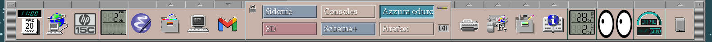
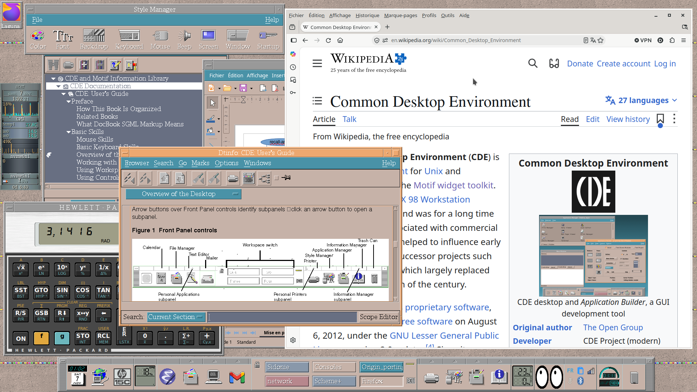
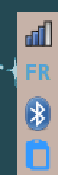
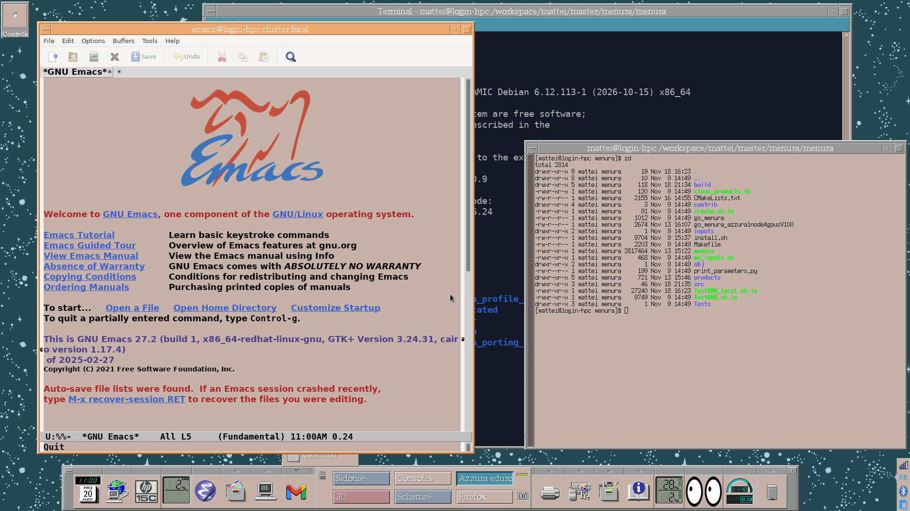

# cde-config

My personal **CDE** (Common Desktop Environment) setup on Ubuntu: the contents of
`~/.dt`, with a Front Panel brought up to date while staying true to the CDE look.

## What's inside

**Front Panel** (`types/*.fp`)
- Dockapps embedded in the panel (`TYPE client` controls): `wmclock` (a click opens
  Google Calendar), `wmcpuload`, `wmmemload`, `wmbattery`, and `xeyes`.
- Buttons for Firefox, the HP-15C simulator, Emacs, Gmail (in Firefox) and an HP
  printer; the Home Folder button opens Nautilus; the CDE trash at the far right.

**System tray** (`tray-panel.sh`): a `stalonetray` column in the bottom-right corner
of the desktop, outside the Front Panel (NsCDE style), on every workspace, growing
upwards as icons appear (network, Bluetooth, clipboard history, IBus, Telegram…).
Outside the panel the buttons of the icons work much better: the right click
(app menu) reaches every icon, GTK 3 applets included, which was impossible inside the
panel where dtwm keeps it for its own menu, and the Front Panel itself is shorter.
It is put on every workspace
by `src/occupyall.c` (`DtWsmOccupyAllWorkspaces`; dtwm ignores `--sticky`) and kept
in the corner when it grows or the screen size changes. Build:
`gcc -O -o ~/.dt/bin/occupyall ~/.dt/src/occupyall.c -I/usr/dt/include -L/usr/dt/lib
-Wl,-rpath,/usr/dt/lib -lDtSvc -ltt -lDtXinerama -lXm -lXt -lX11`.
(`src/trayclick.c`, unused now, turned a middle-click into a right click when the
tray was inside the panel.)

**Subpanels** (`types/fp_dynamic/*.fp`): the CDE File Manager, Nautilus trash, an applications
folder, `xfce4-appfinder`, the CDE calendar, Dropbox (in a terminal that shows its
sync status), power settings, presentation mode, network connections, screen off,
screenshot, qps, Psensor, gkrellm…

**Keyboard** (`dtwmrc`, a copy of `sys.dtwmrc` plus bindings)
- Volume, mute and mic mute → `volume.sh` (a single notification bubble, capped
  at 120 %).
- Brightness → `brightness.sh` (logind `SetBrightness`, perceptual steps, down to
  backlight off).
- Print Screen → `xfce4-screenshooter`.
- Desktop right-click menu: **Close Window** → `src/closewin.c`: a crosshair, click a
  window and only that window is asked to close (`WM_DELETE_WINDOW`), unlike `xkill`
  which kills the whole client with all its windows. (dtwm greys out `f.kill` in the
  root menu.) Build: `gcc -O -o ~/.dt/bin/closewin ~/.dt/src/closewin.c -lX11`.

**Scripts**
- `sessions/sessionetc`: run by CDE at login; starts the dockapps, the tray,
  `nm-applet`, `blueman-applet`, `xfce4-clipman` and Dropbox.
- `panel-applets-watch.sh`: after "Restart Workspace Manager", maps
  `wmcpuload`/`wmmemload` again and relaunches `xeyes` (also after resuming from
  suspend).
- `lock-on-sleep.py`: locks the screen with CDE (`lock-cde.sh`, i.e. `dtaction
  LockDisplay`) before every suspend, holding a logind delay inhibitor like
  `xfce4-screensaver` does. CDE predates suspend and doesn't lock by itself then.
- `battery-alarm.sh`: below 30 % on battery, a sound and a notification every
  minute (below 10 %: a shrill beep and an urgent notification) until the charger is plugged in (`wmbattery -a` writes
  to `/dev/audio`, which no longer exists); `wmbattery -l 30 -c 10` turns its icon yellow/red at the same
  levels.
- `xeyes-panel.sh`, `wmmemload-panel.sh`, `tray-panel.sh`, `xclock-toggle.sh`,
  `presentation-toggle.sh`, `dropbox-*.sh`.

## Installation

1. Copy the files into `~/.dt` (back up your own first).
2. Replace `/home/mattei` with your home directory in the files that contain it:
   `grep -rl /home/mattei ~/.dt`.
3. Make CDE the only screen locker (otherwise `xfce4-screensaver` cannot lock a
   screen CDE has already locked, and the suspend stops on a question):
   `xfconf-query -c xfce4-power-manager -p /xfce4-power-manager/lock-screen-suspend-hibernate -s false`,
   `xfconf-query -c xfce4-screensaver -p /lock/sleep-activation -s false`, and
   `xfconf-query -c xfce4-session -p /general/LockCommand -s $HOME/.dt/lock-cde.sh`
   (for `xflock4`).
4. Right-click the desktop → **Restart Workspace Manager**, then log out and back in
   so that `sessionetc` runs.

Packages used (Ubuntu): `wmclock wmcpuload wmmemload wmbattery x11-apps
stalonetray network-manager-gnome blueman xfce4-clipman xfce4-power-manager
xfce4-screenshooter pavucontrol nautilus xdotool x11-utils libnotify-bin
papirus-icon-theme`.

## Power saving, screen and lock: who does what

**Screen and system sleep: `xfce4-power-manager`** (Desktop Style subpanel →
**Power**, or `xfce4-power-manager-settings`). My settings:

| Setting | On AC | On battery | Tab |
|---|---|---|---|
| Blank the screen (starts the CDE saver, see below) | 20 min | 5 min | Display |
| Screen standby | 40 min | 15 min | Display |
| Screen off | 45 min | 25 min | Display |
| System sleep when inactive | 45 min | never | System |
| Lid closed | suspend | suspend | General |
| Power button | suspend | – | General |

- Don't use "Ask" for the power button: under CDE (no `xfce4-session`) it logs the
  session out at once.
- Keep "Lock screen when system is going to sleep" unchecked: CDE handles the
  lock (below), and two lockers block each other.
- The **presentation mode** button (Desktop Style subpanel) suspends all these
  timers; click it again to turn it off.
- In xfconf, `inactivity-on-battery = 14` means **never** (the slider's lowest
  position), not 14 minutes.

**Screen lock: CDE only**
- After inactivity: Style Manager → **Screen**: saver on at 20 min, lock at 30 min.
- By hand: the padlock on the Front Panel.
- Before every suspend (lid, power button, inactivity): `lock-on-sleep.py`, started
  by `sessionetc`. Nothing to set.

**Left idle**: `xfce4-screensaver` still runs but neither locks nor shows a saver
(`/lock/sleep-activation`, `/saver/enabled` and `/saver/idle-activation/enabled`
are false). Don't turn it back on, or the two lockers fight again: CDE's lock grabs
the keyboard, `xfce4-screensaver` then fails, and the power manager stops the
suspend on a question nobody answers.

**Brightness**: the keys go to `brightness.sh`; "Handle display brightness keys" is
off in the power manager.

**Keyboard backlight** (Acer Aspire A517-53): Linux has no control over it (no
`kbd_backlight` LED, it is driven by the embedded controller). Enable "Keyboard
Lighting Timeout" in the BIOS (F2): the keyboard goes dark after about 30 s without
a key press.

**CDE screen savers** (Style Manager → **Screen**, Screen Saver On): there is only
one X screen saver timeout, and both `dtsession` and the power manager write it
(`XSetScreenSaver`); the power manager rewrites it with its "blank" value at every
AC/battery switch and when presentation mode changes. So the CDE saver actually
starts at the power manager's blank time (20 min on AC, 5 on battery); set the same
value in Style Manager to avoid surprises. Presentation mode sets the timeout to 0,
so no saver. Test right away with `xset s activate`.

- dtsession starts the saver when the X timeout fires and locks (Start Lock −
  Start Saver) later; if Start Lock ≤ Start Saver, or the saver is off, it locks at
  once.
- Style Manager quirk: when the X timeout doesn't match its settings (the power
  manager changed it), the Screen dialog *shows* the saved Start Lock value but
  *sends* the X timeout as the lock time. Move the Start Lock slider before
  clicking OK, then check with `xrdb -query | grep extension`.
- "Blank Screen" in the saver list is just a black screen.

**Order of events**: on AC the saver starts at 20 min, CDE locks at 30 (10 min
after the saver started), the screen goes on standby at 40 and off at 45. On battery the
saver starts at 5 min and CDE locks 10 min later, at 15, when the screen goes on
standby; it is off at 25. There is no automatic suspend on battery.

If suspend is ever delayed again, check `systemd-inhibit --list`: logind lets an
app hold the suspend back for up to `InhibitDelayMaxSec` (30 s on Ubuntu).

## CDE tips learned along the way

- Controls sharing the same `POSITION_HINTS` are ordered by **reverse alphabetical
  order** of their names (hence `ZFirefoxPanel`, `GCpuLoad`…).
- A `TYPE client` control embeds an X window matched by the first string of its
  `WM_CLASS` (`CLIENT_NAME`); such a control can't have a subpanel.
- **No apostrophes in `dtwmrc` comments**: dtwm then silently ignores the bindings
  that follow.
- dtwm can only grab a key that no other program has already grabbed.
- On a `TYPE client` control, dtwm grabs mouse button 3 with any modifier for its
  popup menu: the embedded client never sees a right click. Synthetic clicks
  (`XSendEvent`) reach Qt apps but GTK 3 drops them. Hence the tray outside the
  panel.
- dtwm keeps the top-left corner of a window fixed when the client resizes it,
  whatever its gravity: `tray-panel.sh` moves the tray back into the corner on each
  `ConfigureNotify`.
- `xeyes` 1.3 never repaints its background when a window passes over it:
  `xeyes-panel.sh` starts it with `+present` and gives its drawing window a background
  colour with the small `src/setbg.c` tool, so the X server repaints it instead.
  Build: `gcc -O -o ~/.dt/bin/setbg ~/.dt/src/setbg.c -lX11`.
- Non-Motif X programs such as ImageMagick (`display`, `animate`, `import`, `montage`)
  show **no text in their menus and buttons**: CDE sets `*Font`, `*FontList` and
  `*textFontList` to `-dt-interface ...` without a charset, and a plain X client takes
  the first match, a Chinese `gb2312` font with no Latin letters. `imagemagick.resources`
  (merged by `sessionetc`) points those programs at the Latin-1 variant, which keeps
  the CDE look. Note that `xrdb` runs `cpp`: no apostrophes in its comments either.
- `xss-lock` can't run under CDE ("Failed to set screensaver attributes"): `dtsession`
  already uses the MIT-SCREEN-SAVER extension, which accepts a single client. Hence
  `lock-on-sleep.py`.
- CDE only remembers the workspaces of old-style X clients (`dtcm`, `xload`,
  `xeyes`…); modern apps all come back on the current workspace.

## Notes

Comments in the scripts and commit messages are in French.

## Credits

Most of the added icons (`icons/*.pm`) are converted from the
[Papirus](https://github.com/PapirusDevelopmentTeam/papirus-icon-theme) icon theme
(GPL-3.0). Built with the help of Claude (Anthropic).
