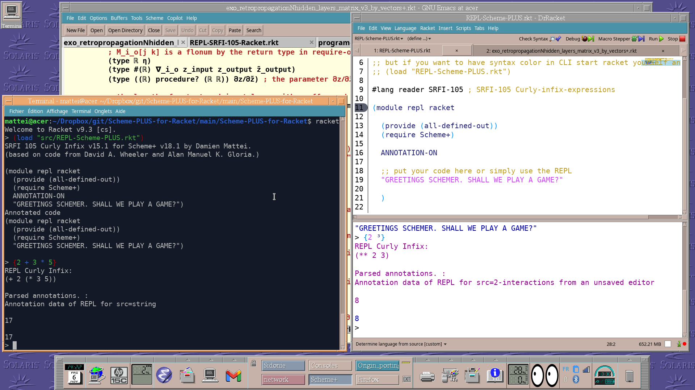
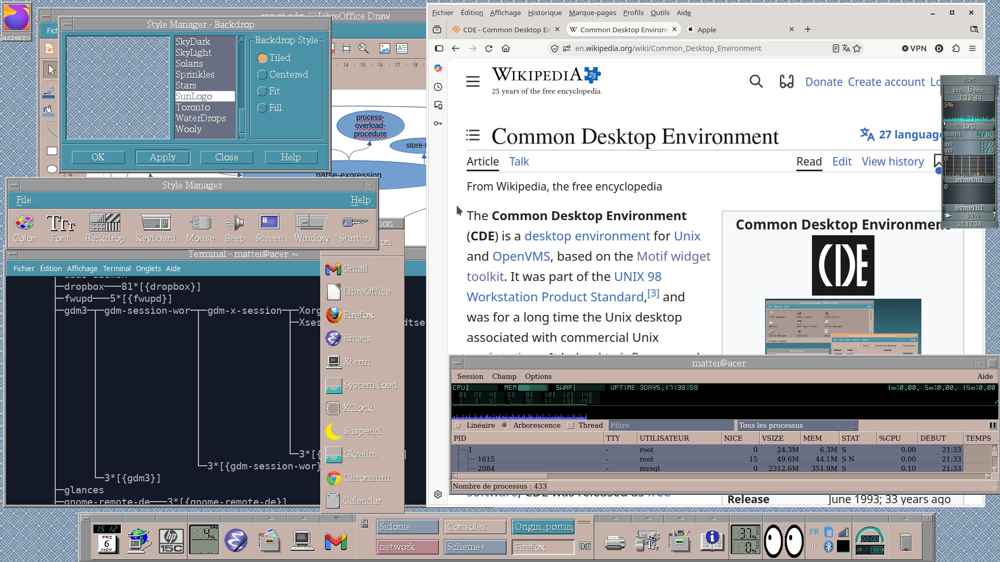

# cde-config

My personal **CDE** (Common Desktop Environment) setup on Ubuntu: the contents of
`~/.dt`, with a Front Panel brought up to date while staying true to the CDE look.

## What's inside

**Front Panel** (`types/*.fp`)
- Dockapps embedded in the panel (`TYPE client` controls): `wmclock` (a click opens
  Google Calendar), `wmcpuload`, `wmmemload`, `wmbattery`, and `xeyes`.
- A 3×2 `stalonetray` system tray inside the panel (network, Bluetooth, clipboard
  history, IBus, Psensor…).
- Buttons for Firefox, the HP-15C simulator, Emacs, Gmail (in Firefox) and an HP
  printer; the CDE trash at the far right.

**Subpanels** (`types/fp_dynamic/*.fp`): Nautilus, Nautilus trash, an applications
folder, `xfce4-appfinder`, the CDE calendar, Dropbox (in a terminal that shows its
sync status), power settings, presentation mode, network connections, screen off,
screenshot, qps, Psensor, gkrellm…

**Keyboard** (`dtwmrc`, a copy of `sys.dtwmrc` plus bindings)
- Volume, mute and mic mute → `volume.sh` (a single notification bubble, capped
  at 120 %).
- Brightness → `brightness.sh` (logind `SetBrightness`, perceptual steps, down to
  backlight off).
- Print Screen → `xfce4-screenshooter`.

**Scripts**
- `sessions/sessionetc`: run by CDE at login; starts the dockapps, the tray,
  `nm-applet`, `blueman-applet`, `xfce4-clipman` and Dropbox.
- `panel-applets-watch.sh`: after "Restart Workspace Manager", maps
  `wmcpuload`/`wmmemload` again and relaunches `xeyes` (also after resuming from
  suspend).
- `xeyes-panel.sh`, `wmmemload-panel.sh`, `tray-panel.sh`, `xclock-toggle.sh`,
  `presentation-toggle.sh`, `dropbox-*.sh`.

## Installation

1. Copy the files into `~/.dt` (back up your own first).
2. Replace `/home/mattei` with your home directory in the files that contain it:
   `grep -rl /home/mattei ~/.dt`.
3. Right-click the desktop → **Restart Workspace Manager**, then log out and back in
   so that `sessionetc` runs.

Packages used (Ubuntu): `wmclock wmcpuload wmmemload wmbattery x11-apps
stalonetray network-manager-gnome blueman xfce4-clipman xfce4-power-manager
xfce4-screenshooter pavucontrol nautilus xdotool x11-utils libnotify-bin
papirus-icon-theme`.

## CDE tips learned along the way

- Controls sharing the same `POSITION_HINTS` are ordered by **reverse alphabetical
  order** of their names (hence `ZFirefoxPanel`, `GCpuLoad`…).
- A `TYPE client` control embeds an X window matched by the first string of its
  `WM_CLASS` (`CLIENT_NAME`); such a control can't have a subpanel.
- **No apostrophes in `dtwmrc` comments**: dtwm then silently ignores the bindings
  that follow.
- dtwm can only grab a key that no other program has already grabbed.
- `xeyes` 1.3 never repaints its background when a window passes over it:
  `xeyes-panel.sh` starts it with `+present` and gives its drawing window a background
  colour with the small `src/setbg.c` tool, so the X server repaints it instead.
  Build: `gcc -O -o ~/.dt/bin/setbg ~/.dt/src/setbg.c -lX11`.
- CDE only remembers the workspaces of old-style X clients (`dtcm`, `xload`,
  `xeyes`…); modern apps all come back on the current workspace.

## Notes

Comments in the scripts and commit messages are in French.

## Credits

Most of the added icons (`icons/*.pm`) are converted from the
[Papirus](https://github.com/PapirusDevelopmentTeam/papirus-icon-theme) icon theme
(GPL-3.0). Built with the help of Claude (Anthropic).
